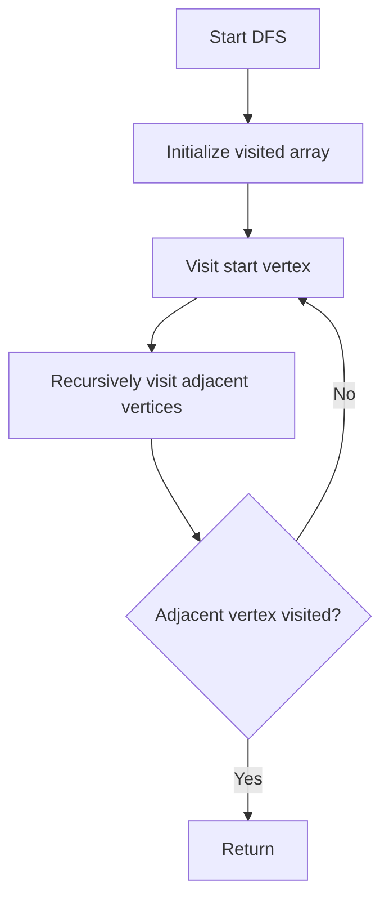
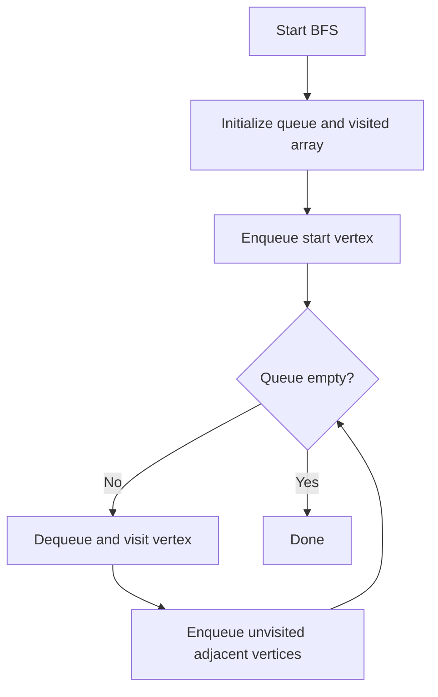
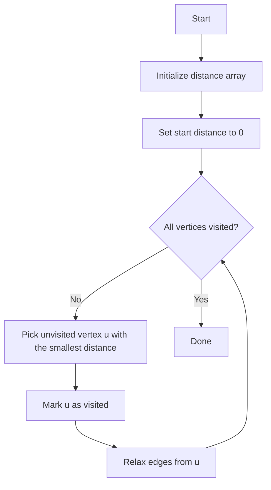

# Graph Data Structure in C

[](https://en.wikipedia.org/wiki/C11_(C_standard_revision))
[](LICENSE)

A general-purpose graph library in C. It stores graphs as adjacency lists and supports directed and undirected graphs, along with common traversal and shortest-path algorithms.

## Data Structure

```
┌─────────────────────────────────────────────────────────┐
│                        Graph                            │
├─────────────────────────────────────────────────────────┤
│  vertices[]  │  vertexCount  │  capacity  │ isDirected │
└──────┬──────────────────────────────────────────────────┘
       │
       ▼
┌─────────────────────────────────────────────────────────┐
│  Vertex[0]    Vertex[1]    Vertex[2]    ...             │
│  ├─ data      ├─ data      ├─ data                      │
│  └─ firstEdge └─ firstEdge └─ firstEdge                 │
│       │            │            │                       │
│       ▼            ▼            ▼                       │
│   ┌──────┐     ┌──────┐     ┌──────┐                    │
│   │Edge  │     │Edge  │     │Edge  │                    │
│   ├─dest │     ├─dest │     ├─dest │                    │
│   ├─weight    ├─weight    ├─weight                      │
│   └─next─┘───►└─next─┘───►└─next─┘───► NULL            │
└─────────────────────────────────────────────────────────┘
```

## API

### Create and destroy

| Function | Description |
| ----------------------------------- | ---------------- |
| `graphCreate(capacity, isDirected)` | Create a graph |
| `graphDestroy(g)` | Destroy the graph and free memory |

### Vertex operations

| Function | Description |
| ------------------------------ | -------------------- |
| `graphAddVertex(g, data)` | Add a vertex |
| `graphRemoveVertex(g, index)` | Remove a vertex |
| `graphGetVertexIndex(g, data)` | Find a vertex index by data |
| `graphGetVertexData(g, index)` | Get vertex data |
| `graphVertexCount(g)` | Get the vertex count |

### Edge operations

| Function | Description |
| ----------------------------------- | -------------- |
| `graphAddEdge(g, from, to, weight)` | Add an edge |
| `graphRemoveEdge(g, from, to)` | Remove an edge |
| `graphHasEdge(g, from, to)` | Check whether an edge exists |
| `graphGetEdgeWeight(g, from, to)` | Get edge weight |

### Traversal

| Function | Description |
| ------------------------- | ------------ |
| `graphDFS(g, startIndex)` | Depth-first search |
| `graphBFS(g, startIndex)` | Breadth-first search |

### Algorithms

| Function | Description |
| ------------------------------------------ | -------------------- |
| `graphDijkstra(g, startIndex, dist, prev)` | Dijkstra shortest paths |
| `graphInDegree(g, index)` | Compute in-degree |
| `graphOutDegree(g, index)` | Compute out-degree |

## Example

```c
#include <stdio.h>

int main() {
    // Create a directed weighted graph
    Graph* g = graphCreate(10, true);

    // Add vertices
    graphAddVertex(g, 0);
    graphAddVertex(g, 1);
    graphAddVertex(g, 2);

    // Add weighted edges
    graphAddEdge(g, 0, 1, 10);  // 0 -> 1, weight 10
    graphAddEdge(g, 0, 2, 5);   // 0 -> 2, weight 5
    graphAddEdge(g, 1, 2, 2);   // 1 -> 2, weight 2

    // Traversal
    graphDFS(g, 0);
    graphBFS(g, 0);

    // Dijkstra
    int dist[3], prev[3];
    graphDijkstra(g, 0, dist, prev);

    // Print the graph
    graphPrint(g);

    // Destroy the graph
    graphDestroy(g);

    return 0;
}
```

## Algorithm Flow

### DFS



### BFS



### Dijkstra



## Build and Run

```bash
# Build
gcc -o graph graph.c -std=c11

# Run
./graph
```

Use your actual source filename if it differs from `graph.c`.

## Sample Output

```
C:\Users\anjuxi\Desktop\graph>a.exe
=== Graph Test ===

[Undirected graph]

Graph (undirected, 5 vertices):
Vertex[0](data=0): -> [2](weight=1) -> [1](weight=1)
Vertex[1](data=1): -> [3](weight=1) -> [0](weight=1)
Vertex[2](data=2): -> [3](weight=1) -> [0](weight=1)
Vertex[3](data=3): -> [4](weight=1) -> [2](weight=1) -> [1](weight=1)
Vertex[4](data=4): -> [3](weight=1)

DFS: 0 2 3 4 1
BFS: 0 2 1 3 4
Degree of vertex 0: 2
Undirected graph destroyed

[Directed weighted graph]

Graph (directed, 5 vertices):
Vertex[0](data=0): -> [2](weight=5) -> [1](weight=10)
Vertex[1](data=1): -> [3](weight=1) -> [2](weight=2)
Vertex[2](data=2): -> [4](weight=2) -> [3](weight=9) -> [1](weight=3)
Vertex[3](data=3): -> [4](weight=4)
Vertex[4](data=4): -> [3](weight=6)

DFS: 0 2 4 3 1
BFS: 0 2 1 4 3
Vertex 1 in-degree: 2, out-degree: 2

Shortest paths from vertex 0:
To vertex[0]: distance=0, path=0
To vertex[1]: distance=8, path=0 2 1
To vertex[2]: distance=5, path=0 2
To vertex[3]: distance=9, path=0 2 1 3
To vertex[4]: distance=7, path=0 2 4

After removing edge 0->1:

Graph (directed, 5 vertices):
Vertex[0](data=0): -> [2](weight=5)
Vertex[1](data=1): -> [3](weight=1) -> [2](weight=2)
Vertex[2](data=2): -> [4](weight=2) -> [3](weight=9) -> [1](weight=3)
Vertex[3](data=3): -> [4](weight=4)
Vertex[4](data=4): -> [3](weight=6)

Directed graph destroyed
```

## Dependencies

[](https://en.wikipedia.org/wiki/C_standard_library)

- Standard C library: `<stdio.h>`, `<stdlib.h>`, `<stdbool.h>`, `<limits.h>`
- Compiler: GCC or Clang with C11 support

## Time Complexity

| Operation | Time complexity |
| ------------ | ---------- |
| Add vertex | O(1) |
| Remove vertex | O(V + E) |
| Add edge | O(1) |
| Remove edge | O(E) |
| DFS | O(V + E) |
| BFS | O(V + E) |
| Dijkstra | O(V²) |

> V = number of vertices, E = number of edges

## Author

**Ailan Anjuxi (谙弆悕博士)**

- Email: [anjuxi.ME@outlook.com](mailto:anjuxi.ME@outlook.com)
- SIP: [sip:anjuxi@sip.linphone.org](sip:anjuxi@sip.linphone.org)

---

*This project is for learning and teaching. It demonstrates a basic graph implementation and common graph algorithms.*
