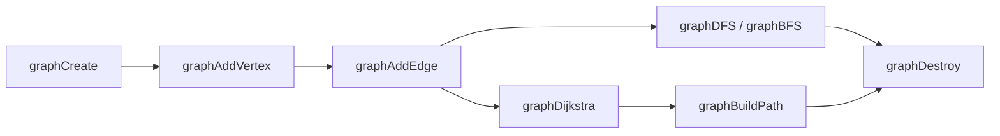

# C-graph

[](https://en.wikipedia.org/wiki/C11_(C_standard_revision))
[](LICENSE)

[中文文档](README_CN.md)

## Introduction

This is an adjacency-list graph implementation in C11. It supports directed and undirected graphs with integer edge weights, plus DFS, BFS, Dijkstra shortest paths, and path reconstruction.

The project started as a single `图.cpp` file with a fixed vertex capacity. It is now split into a header, an implementation file, a demo, and a test program. The vertex array grows automatically, vertex removal keeps edge indices consistent, and traversal reports vertices through a callback.

The usual workflow:



What it covers:

- Directed and undirected graphs, integer weights.
- Automatic capacity growth by doubling.
- Undirected edges stored in both directions; self-loops stored once.
- Iterative DFS and array-based BFS.
- Dijkstra with a helper that rebuilds the path from `prev`.

## Dependencies

[](https://en.wikipedia.org/wiki/C_standard_library)

- C standard library: `stdio.h`, `stdlib.h`, `stdbool.h`, `stdint.h`, `limits.h`.
- GCC or Clang with C11 support.
- GNU Make is optional; plain gcc commands work as well.

## Project structure

```
.
├── graph.h            Types and public API
├── graph.c            Implementation
├── main.c             Demo program
├── tests/
│   └── test_graph.c   Assert-based tests
├── Makefile           Build and test targets
├── README.md          English documentation
├── README_CN.md       Chinese documentation
└── LICENSE
```

The vertex array is stored contiguously, and each vertex owns a linked list of outgoing edges:

```
Graph
├── vertices[]
│   ├── data
│   └── firstEdge ──► EdgeNode(dest, weight, next) ──► ... ──► NULL
├── vertexCount
├── capacity
└── isDirected
```

## Usage

### Build and run

```bash
gcc -std=c11 -Wall -Wextra -Wpedantic -O2 -o graph_demo main.c graph.c
./graph_demo
```

Or with make:

```bash
make
./graph_demo
```

On Windows the binary is `graph_demo.exe`, so run `.\graph_demo.exe`.

### Test

```bash
gcc -std=c11 -Wall -Wextra -Wpedantic -I. -o test_graph tests/test_graph.c graph.c
./test_graph
```

Or simply `make test`. The tests cover capacity growth, adding and removing edges, self-loops, index changes after vertex removal, traversal order, and shortest paths.

### API

| Function | Description |
| --- | --- |
| `graphCreate(capacity, isDirected)` | Create a graph; `capacity` is only the initial size |
| `graphDestroy(g)` | Free the vertex array and all edge nodes |
| `graphReserve(g, capacity)` | Ensure room for at least `capacity` vertices |
| `graphAddVertex(g, data)` | Add a vertex, returns its index or `-1` |
| `graphRemoveVertex(g, index)` | Remove a vertex; later indices shift down |
| `graphGetVertexIndex(g, data)` | Find a vertex by data, `-1` if absent |
| `graphGetVertexData(g, index)` | Vertex data, `INT_MIN` for a bad index |
| `graphVertexCount(g)` | Number of vertices |
| `graphAddEdge(g, from, to, weight)` | Add an edge; undirected graphs get the reverse edge |
| `graphRemoveEdge(g, from, to)` | Remove an edge and its reverse edge |
| `graphHasEdge(g, from, to)` | Check whether an edge exists |
| `graphGetEdgeWeight(g, from, to)` | Edge weight, `INT_MAX` if absent |
| `graphDFS(g, start, visit, userData)` | Depth-first traversal |
| `graphBFS(g, start, visit, userData)` | Breadth-first traversal |
| `graphDijkstra(g, start, dist, prev)` | Shortest paths with non-negative weights |
| `graphBuildPath(prev, vertexCount, end, path, capacity)` | Rebuild a path from `prev` |
| `graphInDegree(g, index)` | In-degree; equals the degree in undirected graphs |
| `graphOutDegree(g, index)` | Out-degree; equals the degree in undirected graphs |
| `graphPrint(g)` | Print the adjacency lists |

`GraphVisitFn` is `void (*)(int index, int data, void* userData)`. The `userData` pointer is passed back unchanged on every call.

### Example

```c
#include "graph.h"
#include <stdio.h>

static void printVertex(int index, int data, void* userData) {
    (void)index;
    (void)userData;
    printf("%d ", data);
}

int main(void) {
    Graph* g = graphCreate(10, true);

    for (int i = 0; i < 3; i++) {
        graphAddVertex(g, i);
    }
    graphAddEdge(g, 0, 1, 10);
    graphAddEdge(g, 0, 2, 5);
    graphAddEdge(g, 1, 2, 2);

    graphDFS(g, 0, printVertex, NULL);
    printf("\n");

    int dist[3];
    int prev[3];
    graphDijkstra(g, 0, dist, prev);
    printf("dist to 2 = %d\n", dist[2]);

    graphDestroy(g);
    return 0;
}
```

### Sample output

```
[Undirected graph]
Graph (undirected, 5 vertices):
Vertex[0](data=0): -> [2](weight=1) -> [1](weight=1)
...
DFS: 0 2 3 4 1
BFS: 0 2 1 3 4

Shortest paths from vertex 0:
To vertex[0]: distance=0, path=0
To vertex[1]: distance=8, path=0 2 1
To vertex[2]: distance=5, path=0 2
To vertex[3]: distance=9, path=0 2 1 3
To vertex[4]: distance=7, path=0 2 4
```

Run `./graph_demo` for the full output.

## Contributing

Bug reports and pull requests are welcome. Keep the code C11-compatible, add a test when behavior changes, and run `make test` before submitting.

## Contact

**Ailan Anjuxi**

- 📫 Email: [anjuxi.ME@outlook.com](mailto:anjuxi.ME@outlook.com)
- 📞 SIP: [sip:anjuxi@sip.linphone.org](sip:anjuxi@sip.linphone.org)

## License

MIT. See [LICENSE](LICENSE).
